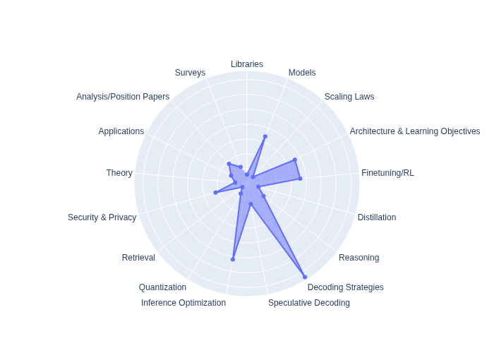

# awesome-dLLM-resources
Frequently updated list of dLLM (Diffusion Large Language Models) papers, models, and other resources. 

Maintained By Suhas Pai and Xiaojun Ren. For an overview of this field, see our <i><a href="https://iclr-blogposts.github.io/2026/blog/2026/dllm/" target="_blank">ICLR 2026 blog post</a></i>.

Make a PR if you want to include your paper on this list or if you've found a cool paper that you think should be included in this list :)

## Libraries
- **Block Parallelism For Efficient Distributed Long-Context Diffusion Language Model Training** — *September 16, 2026* <i><a href="https://arxiv.org/abs/2609.19242" target="_blank">arXiv</a>, <a href="https://github.com/ScalingIntelligence/Turbo-dLLM" target="_blank">GitHub</a></i>
- **dlmserve: First OSS Serving Engine for Diffusion Language Models** - *May 25, 2026* <i><a href="https://github.com/iOptimizeThings/dlmserve" target="_blank">GitHub</a></i>
- **DiRL: An Efficient Training Framework for Diffusion Language Models** - *November 18, 2025* <i><a href="https://github.com/OpenMOSS/DiRL" target="_blank">GitHub</a></i>
- **dLLM: Simple Diffusion Language Modeling** - *October 11, 2025* <i><a href="https://github.com/ZHZisZZ/dllm" target ="_blank">GitHub</a></i>

## Models
- **Nemotron-Labs-Diffusion-Uni: Elastic Self-Refining Unified Diffusion LLM with Cross-Paradigm On-Policy Distillation** — *October 27, 2026* <i><a href="https://arxiv.org/abs/2610.36466" target="_blank">arXiv</a></i>
- **Trion-1: Unifying Language, Protein Sequence, and Structure with Diffusion Language Models** — *October 22, 2026* <i><a href="https://arxiv.org/abs/2610.31215" target="_blank">arXiv</a></i>
- **Large Flow Language Models** — *October 20, 2026* <i><a href="https://arxiv.org/abs/2610.28559" target="_blank">arXiv</a></i>
- **Large Language Continuous Diffusion Models** — *October 2, 2026* <i><a href="https://arxiv.org/abs/2610.02665" target="_blank">arXiv</a></i>
- **Rethinking Diffusion Large Language Models via Time-aware Weighting and Block-oriented Refinements** — *October 2026* (EMNLP 2026) <i><a href="https://aclanthology.org/2026.emnlp-main.1836/" target="_blank">ACL Anthology</a></i>
- **dQwen3.5: Hybrid-Attention Diffusion Language Models** — *September 17, 2026* <i><a href="https://arxiv.org/abs/2609.20751" target="_blank">arXiv</a></i>
- **Zarya: A Hybrid Autoregressive–Masked Diffusion Language Model with Flexible Training and Dual-Mode Inference** — *September 17, 2026* <i><a href="https://arxiv.org/abs/2609.19868" target="_blank">arXiv</a></i>
- **AURORA-LM: Autoencoding Unified Representation for Continuous-Latent Diffusion Language Modeling** — *August 3, 2026* <i><a href="https://arxiv.org/abs/2608.02602" target="_blank">arXiv</a></i>
- **DiffusionGemma** — *July 31, 2026* <i><a href="https://arxiv.org/abs/2608.00146" target ="_blank">arXiv</a></i>
- **Continuous Latent Diffusion Language Model** — *May 7, 2026* <i><a href="https://arxiv.org/abs/2605.06548" target ="_blank">arXiv</a></i>
- **W1-4B-dLLM: Whaletech Diffusion LLM** — *April 13, 2026* <i><a href="https://huggingface.co/WhaletechAI/W1-4B-dLLM-Base" target="_blank">Hugging Face</a></i> <i><a href="https://vibe.whaletech.ai/" target="_blank">Demo</a></i>
- **LLaDA2.0: Scaling Up Diffusion Language Models to 100B** — *December 10, 2025* <i><a href="https://www.arxiv.org/abs/2512.15745" target ="_blank">arXiv</a></i>
- **Causal Diffusion Language Models** - *December 4, 2025* <i><a href ="https://www.guidelabs.ai/post/block-causal-diffusion-language-model/" target ="_blank">Blog Post</a></i>
- **Soft-Masked Diffusion Language Models** — *October 20, 2025* <i><a href="https://arxiv.org/abs/2510.17206" target ="_blank">arXiv</a></i>
- **UltraLLaDA: Scaling the Context Length to 128K for Diffusion Large Language Models** — *October 12, 2025* <i><a href="https://arxiv.org/abs/2510.10481" target="_blank">arXiv</a></i>
- **RND1: Simple, Scalable AR-to-Diffusion Conversion** — *October 9, 2025* <i><a href="https://www.radicalnumerics.ai/blog/rnd1" target="_blank">Blog Post</a></i>
- **SDAR: A Synergistic Diffusion-AutoRegression Paradigm for Scalable Sequence Generation** - *October 7, 2025* <i><a href="https://arxiv.org/abs/2510.06303" target="_blank">arXiv</a></i>
- **Syntax-Guided Diffusion Language Models with User-Integrated Personalization** — *October 2, 2025* <i><a href="https://arxiv.org/abs/2510.01028" target="_blank">arXiv</a></i>
- **CoDA: Coding LM via Diffusion Adaptation** — *September 27, 2025* <i><a href="https://arxiv.org/abs/2510.03270" target="_blank">arXiv</a></i>
- **LLaDA-MoE: A Sparse MoE Diffusion Language Model** — *September 25, 2025* <i><a href="https://arxiv.org/abs/2509.24389" target="_blank">arXiv</a></i>
- **Dream 7B: Diffusion Large Language Models** - *August 21, 2025* <i><a href="https://arxiv.org/abs/2508.15487" target="_blank">arXiv</a></i>
- **DiffuCoder: Understanding and Improving Masked Diffusion Models for Code Generation** — *June 25, 2025* <i><a href="https://arxiv.org/abs/2506.20639" target ="_blank">arXiv</a></i>
- **Mercury: Ultra-Fast Language Models Based on Diffusion** — *June 17, 2025* <i><a href="https://arxiv.org/abs/2506.17298" target ="_blank">arXiv</a></i>
- **LLaDA 1.5: Variance-Reduced Preference Optimization for Large Language Diffusion Models** — *May 25, 2025* <i><a href="https://arxiv.org/abs/2505.19223" target="_blank">arXiv</a></i>
- **Large Language Diffusion Models** — *February 14, 2025* <i><a href="https://arxiv.org/abs/2502.09992" target="_blank">arXiv</a></i>

## Scaling Laws
- **Revisiting the 16x Pretraining Compute Gap between Diffusion and Autoregressive Language Models** — *October 13, 2026* <i><a href="https://arxiv.org/abs/2610.17590" target="_blank">arXiv</a></i>
- **LLaDA MoE v2: Scaling Mixture-of-Experts Diffusion Language Models** — *August 4, 2026* <i><a href="https://arxiv.org/abs/2608.03457" target="_blank">arXiv</a></i>
- **Continuous Diffusion Scales Competitively with Discrete Diffusion for Language** — *May 18, 2026* <i><a href="https://arxiv.org/abs/2605.18530" target="_blank">arXiv</a></i>
- **Diffusion Language Models Are Super Data Learners** — *October 1, 2025* <i><a href="https://jinjieni.github.io/dlms-are-super-data-learners/resources/pdf/Diffusion_Language_Models_are_Super_Data_Learners.pdf" target="_blank">GitHub</a></i>
- **Diffusion Beats Autoregressive in Data-Constrained Settings** — *July 21, 2025* <i><a href="https://arxiv.org/abs/2507.15857" target="_blank">arXiv</a></i>

## Architecture & Learning Objectives
- **BYOD: Build Your Own DLM - Efficient Autoregressive-to-Diffusion Language Model Conversion** — *October 30, 2026* <i><a href="https://arxiv.org/abs/2610.41574" target="_blank">arXiv</a></i>
- **TDLM: Adaptive Temporal Integration for Diffusion Language Models** — *October 27, 2026* <i><a href="https://arxiv.org/abs/2610.36940" target="_blank">arXiv</a></i>
- **Spherical Brownian Diffusion for Language Modeling** — *October 26, 2026* <i><a href="https://arxiv.org/abs/2610.35101" target="_blank">arXiv</a></i>
- **Hierarchical Masked Diffusion Language Models** — *October 21, 2026* <i><a href="https://arxiv.org/abs/2610.29255" target="_blank">arXiv</a></i>
- **Looped Uniform Diffusion Language Models** — *October 21, 2026* <i><a href="https://arxiv.org/abs/2610.30066" target="_blank">arXiv</a></i>
- **Learning to Couple: Context-Adaptive Joint Denoising for Diffusion Language Models** — *October 19, 2026* <i><a href="https://arxiv.org/abs/2610.25723" target="_blank">arXiv</a></i>
- **Designing Transformers for Continuous Diffusion Language Models** — *October 15, 2026* <i><a href="https://arxiv.org/abs/2610.22330" target="_blank">arXiv</a></i>
- **On the Design Space of Continuous Diffusion Language Models** — *October 9, 2026* <i><a href="https://arxiv.org/abs/2610.13834" target="_blank">arXiv</a></i>
- **Denoising Hierarchical Representations: Joint Continuous Diffusion for Language Modeling** — *October 6, 2026* <i><a href="https://arxiv.org/abs/2610.08738" target="_blank">arXiv</a></i>
- **Noise Your Prompt: Noising Conditioning Tokens in Continuous Diffusion Language Models** — *October 6, 2026* <i><a href="https://arxiv.org/abs/2610.09145" target="_blank">arXiv</a></i>
- **ALoDLM: Adaptively Looped Diffusion Language Models** — *October 3, 2026* <i><a href="https://arxiv.org/abs/2610.04198" target="_blank">arXiv</a></i>
- **Clock Diffusion: Efficient Semi-Autoregressive Continuous Diffusion Language Models** — *October 1, 2026* <i><a href="https://arxiv.org/abs/2610.00894" target="_blank">arXiv</a></i>
- **Hierarchical Continuous Diffusion Language Models** — *October 1, 2026* <i><a href="https://arxiv.org/abs/2610.02193" target="_blank">arXiv</a></i>
- **Know When to Hold 'em: Correct-Token Retention in Uniform-State Diffusion Language Models** — *October 1, 2026* <i><a href="https://arxiv.org/abs/2610.01275" target="_blank">arXiv</a></i>
- **TAP: Policy Interfaces for Diffusion Language Models** — *October 2026* (EMNLP 2026) <i><a href="https://aclanthology.org/2026.emnlp-main.2623/" target="_blank">ACL Anthology</a></i>
- **Alpha Diffusion Language Models: Factorization Alone Is Not the Problem** — *September 29, 2026* <i><a href="https://arxiv.org/abs/2609.38066" target="_blank">arXiv</a></i>
- **On Trajectory-Aware Training for Masked Diffusion Language Models** — *September 29, 2026* <i><a href="https://arxiv.org/abs/2609.37974" target="_blank">arXiv</a></i>
- **Learning to Re-Draft: A Variational Stackelberg Game for Discrete Diffusion** — *September 28, 2026* <i><a href="https://arxiv.org/abs/2609.35166" target="_blank">arXiv</a></i>
- **One Latent, Many Tokens: Jointly Learning Compressed Embeddings for Efficient Language Diffusion** — *September 27, 2026* <i><a href="https://arxiv.org/abs/2609.33698" target="_blank">arXiv</a></i>
- **Less Uniform Discrete Diffusion is More Powerful and Scalable** — *September 21, 2026* <i><a href="https://arxiv.org/abs/2609.35817" target="_blank">arXiv</a></i>
- **DA-DLM: Explicitly Modeling Token Dependencies in Diffusion Language Models** — *September 14, 2026* <i><a href="https://arxiv.org/abs/2609.15070" target="_blank">arXiv</a></i>
- **Fixed State, Long Reach: What a Constant-Size Cache Buys Block Diffusion at Scale** — *September 9, 2026* <i><a href="https://arxiv.org/abs/2609.11998" target="_blank">arXiv</a></i>
- **Reducing Pretraining-Generation Mismatch in Diffusion Language Models** — *August 10, 2026* <i><a href="https://arxiv.org/abs/2608.09424" target="_blank">arXiv</a></i>
- **Retrofitting Linear Attention into Diffusion Language Models** — *August 6, 2026* <i><a href="https://arxiv.org/abs/2608.06628" target="_blank">arXiv</a></i>
- **DSL-LLaDA: Scaling Continuous Denoising to 8B Masked Diffusion LMs** - *May 31, 2026* <i><a href="https://arxiv.org/abs/2606.01024" target="_blank">arXiv</a></i>
- **WaveFilter: Enhancing the Long-Context Capability of Diffusion LLMs via Wavelet-Guided KV Cache Filtering** - *May 30, 2026* <i><a href="https://arxiv.org/abs/2606.00724" target="_blank">arXiv</a></i>
- **Triplet-Block Diffusion RWKV** - *May 25, 2026* <i><a href="https://arxiv.org/abs/2605.25969" target="_blank">arXiv</a></i>
- **DLLM-JEPA: Joint Embedding Predictive Architectures for Masked Diffusion Language Models** - *May 24, 2026* <i><a href="https://arxiv.org/abs/2606.00091" target="_blank">arXiv</a></i>
- **DiLaDiff: Distilled Latent-Augmented Diffusion for Language Modeling** - *May 22, 2026* <i><a href="https://arxiv.org/abs/2605.23605" target="_blank">arXiv</a></i>
- **Drifting Objectives for Refining Discrete Diffusion Language Models** - *May 19, 2026* <i><a href="https://arxiv.org/abs/2605.19470" target="_blank">arXiv</a></i>
- **Dynamic Chunking for Diffusion Language Models** - *May 15, 2026* <i><a href="https://arxiv.org/abs/2605.15676" target="_blank">arXiv</a></i>
- **Where Should Diffusion Enter a Language Model? Geometry-Guided Hidden-State Replacement** - *May 14, 2026* <i><a href="https://arxiv.org/abs/2605.14368" target="_blank">arXiv</a></i>
- **BitLM: Unlocking Multi-Token Language Generation with Bitwise Continuous Diffusion** - *May 12, 2026* <i><a href="https://arxiv.org/abs/2605.11577" target="_blank">arXiv</a></i>
- **ELF: Embedded Language Flows** - *May 11, 2026* <i><a href="https://arxiv.org/abs/2605.10938" target="_blank">arXiv</a></i>
- **How to Train Your Latent Diffusion Language Model Jointly With the Latent Space** - *May 8, 2026* <i><a href="https://arxiv.org/abs/2605.07933" target="_blank">arXiv</a></i>
- **TextLDM: Language Modeling with Continuous Latent Diffusion** - *May 8, 2026* <i><a href="https://arxiv.org/abs/2605.07748" target="_blank">arXiv</a></i>
- **Token Time Continuous Diffusion for Language Modeling** - *May 7, 2026* <i><a href="https://arxiv.org/abs/2607.14106" target="_blank">arXiv</a></i>
- **Towards Closing the Autoregressive Gap in Language Modeling via Entropy-Gated Continuous Bitstream Diffusion** - *May 7, 2026* <i><a href="https://arxiv.org/abs/2605.07013" target="_blank">arXiv</a></i>
- **From AR to Diffusion: Efficiently Adapting Large Language Models with Strictly Causal and Elastic Horizons** - *April 11, 2026* <i><a href="https://arxiv.org/abs/2605.27387" target="_blank">arXiv</a></i>
- **Beyond Hard Masks: Progressive Token Evolution for Diffusion Language Models** — *January 16, 2026* <i><a href="https://arxiv.org/abs/2601.07351" target="_blank">arXiv</a>, <a href="https://github.com/aim-uofa/EvoTokenDLM" target="_blank">Code</a></i>
- **CANDI: Hybrid Discrete-Continuous Diffusion Models** - *October 26, 2025* <i><a href="https://arxiv.org/abs/2510.22510" target="_blank">arXiv</a></i>
- **Any-Order GPT as Masked Diffusion Model: Decoupling Formulation and Architecture** — *June 24, 2025* <i><a href="https://arxiv.org/abs/2506.19935" target="_blank">arXiv</a></i>

## Finetuning/RL
- **FEROM: Frontier Endogenous Reveal-Order Marginal Policy Optimization for Masked Diffusion LMs** — *November 7, 2026* <i><a href="https://arxiv.org/abs/2611.10369" target="_blank">arXiv</a></i>
- **PBPO: Prefix-Block Policy Optimization for Diffusion Language Models** — *November 5, 2026* <i><a href="https://arxiv.org/abs/2611.07783" target="_blank">arXiv</a></i>
- **Train the Sampler You Run: Few-Step Masked Diffusion Language Models via Mixture-Likelihood Fine-Tuning** — *November 2, 2026* <i><a href="https://arxiv.org/abs/2611.02666" target="_blank">arXiv</a></i>
- **See Every Block Once: Variance-Reduced Post-Training for Masked Diffusion Language Models** — *November 2026* (AACL-IJCNLP 2026) <i><a href="https://aclanthology.org/2026.aacl-long.263/" target="_blank">ACL Anthology</a></i>
- **DTCA: Denoising Token Credit Assignment for Reinforcement Learning in Diffusion Language Models** — *October 26, 2026* <i><a href="https://arxiv.org/abs/2610.35201" target="_blank">arXiv</a></i>
- **ForkGRPO: Efficient Exploration and Fine-Grained Credit Assignment for Diffusion Language Models** — *October 14, 2026* <i><a href="https://arxiv.org/abs/2610.19408" target="_blank">arXiv</a></i>
- **On-Policy Residual Learning for Diffusion Language Models** — *October 14, 2026* <i><a href="https://arxiv.org/abs/2610.20687" target="_blank">arXiv</a>, <a href="https://github.com/Introspective-Diffusion/DLMRT" target="_blank">Inference Engine</a></i>
- **A Few More Tokens Ahead: Reinforcing Parallelism in Diffusion LLMs** — *October 13, 2026* <i><a href="https://arxiv.org/abs/2610.18200" target="_blank">arXiv</a></i>
- **Backpropagating Verifier Rewards Through Continuous Flow Language Models** — *October 13, 2026* <i><a href="https://arxiv.org/abs/2610.19080" target="_blank">arXiv</a></i>
- **Match the Canvas, Not Just the Answer: Predictability-Aware SFT for Diffusion Language Models** — *October 13, 2026* <i><a href="https://arxiv.org/abs/2610.18001" target="_blank">arXiv</a></i>
- **Outcome-Routed Distillation and Reinforcement Learning for Diffusion Language Models** — *October 13, 2026* <i><a href="https://arxiv.org/abs/2610.19271" target="_blank">arXiv</a></i>
- **RL Post-Training Diffusion Language Models Along Their Own Generation Paths** — *October 12, 2026* <i><a href="https://arxiv.org/abs/2610.17266" target="_blank">arXiv</a></i>
- **Representation-Space MMD for Diffusion Language Models** — *October 5, 2026* <i><a href="https://arxiv.org/abs/2610.06648" target="_blank">arXiv</a></i>
- **Fine-Tuning Diffusion Language Models with Context Selection and Target Weighting** — *September 29, 2026* <i><a href="https://arxiv.org/abs/2609.38385" target="_blank">arXiv</a></i>
- **Informed Masking: Structure-Aware Perturbation for Reinforcement Learning in Diffusion Large Language Models** — *September 22, 2026* <i><a href="https://arxiv.org/abs/2609.25927" target="_blank">arXiv</a></i>
- **CanvasAnneal: Curriculum Reinforcement Learning for Diffusion Language Models** — *September 11, 2026* <i><a href="https://arxiv.org/abs/2609.13060" target="_blank">arXiv</a></i>
- **Beyond On-Policy Exploration: Integrating External Policy Rollouts for Reinforcement Learning in Diffusion Language Models** — *August 3, 2026* <i><a href="https://arxiv.org/abs/2608.01717" target="_blank">arXiv</a></i>
- **Mask-Aware Policy Gradients for Diffusion Language Models** — *July 16, 2026* <i><a href="https://arxiv.org/abs/2607.15200" target="_blank">arXiv</a></i>
- **Read the Trace, Steer the Path: Trajectory-Aware Reinforcement Learning for Diffusion Language Models** — *June 3, 2026* <i><a href="https://arxiv.org/abs/2606.04396" target="_blank">arXiv</a></i>
- **Knowledge Editing in Masked Diffusion Language Models** — *June 2, 2026* <i><a href="https://arxiv.org/abs/2606.03924" target="_blank">arXiv</a></i>
- **Revise, Don't Freeze: Sampler-Matched Training for Self-Correcting Masked Diffusion Language Models** — *May 31, 2026* <i><a href="https://arxiv.org/abs/2606.01026" target="_blank">arXiv</a></i>
- **Learnability-Informed Fine-Tuning of Diffusion Language Models** — *May 21, 2026* <i><a href="https://arxiv.org/abs/2605.22939" target="_blank">arXiv</a></i>
- **Beyond Mode-Seeking RL: Trajectory-Balance Post-Training for Diffusion Language Models** — *May 13, 2026* <i><a href="https://arxiv.org/abs/2605.13935" target="_blank">arXiv</a></i>
- **Self-Distilled Trajectory-Aware Boltzmann Modeling: Bridging the Training-Inference Discrepancy in Diffusion Language Models** — *May 12, 2026* <i><a href="https://arxiv.org/abs/2605.11854" target="_blank">arXiv</a></i>
- **Relative Score Policy Optimization for Diffusion Language Models** — *May 11, 2026* <i><a href="https://arxiv.org/abs/2605.10218" target="_blank">arXiv</a></i>
- **DACA-GRPO: Denoising-Aware Credit Assignment for Reinforcement Learning in Diffusion Language Models** — *May 8, 2026* <i><a href="https://arxiv.org/abs/2605.16342" target="_blank">arXiv</a></i>
- **Guidance Is Not a Hyperparameter: Learning Dynamic Control in Diffusion Language Models** — *May 8, 2026* <i><a href="https://arxiv.org/abs/2605.07701" target="_blank">arXiv</a></i>
- **FlowLM: Few-Step Language Modeling via Diffusion-to-Flow Adaptation** — *April 6, 2026* <i><a href="https://arxiv.org/abs/2605.20199" target="_blank">arXiv</a></i>
- **Principled RL for Diffusion LLMs Emerges from a Sequence-Level Perspective** — *December 3, 2025* <i><a href="https://arxiv.org/abs/2512.03759" target="_blank">arXiv</a></i>
- **Diffusion LLM with Native Variable Generation Lengths: Let [EOS] Lead the Way** — *October 28, 2025* <i><a href="https://arxiv.org/abs/2510.24605" target="_blank">arXiv</a></i>
- **Principled and Tractable RL for Reasoning with Diffusion Language Models** — *October 5, 2025* <i><a href="https://arxiv.org/abs/2510.04019" target="_ blank">arXiv</a></i>
- **Fine-Tuning Masked Diffusion for Provable Self-Correction** — *October 1, 2025* <i><a href="https://arxiv.org/abs/2510.01384" target="_ blank">arXiv</a></i>
- **WeFT: Weighted Entropy-Driven Fine-Tuning for dLLMs** — *September 25, 2025* <i><a href="https://arxiv.org/abs/2509.20863" target="_ blank">arXiv</a></i>
- **Inpainting-Guided Policy Optimization for Diffusion Large Language Models** — *September 12, 2025* <i><a href="https://arxiv.org/abs/2509.10396" target="_ blank">arXiv</a></i>
- **Revolutionizing Reinforcement Learning Framework for Diffusion Large Language Models** — *September 8, 2025* <i><a href="https://arxiv.org/abs/2509.06949" target="_blank">arXiv</a></i>

## Distillation
- **Bidirectional Centered Score Matching for Discrete Diffusion Distillation** — *November 3, 2026* <i><a href="https://arxiv.org/abs/2611.04279" target="_blank">arXiv</a></i>
- **HiLo-RD: Cross-Budget Self-Distillation for Masked Diffusion Language Models** — *October 27, 2026* <i><a href="https://arxiv.org/abs/2610.36901" target="_blank">arXiv</a></i>
- **Learning When to Commit: Schedule Distillation for Fast Diffusion Language Models** — *October 26, 2026* <i><a href="https://arxiv.org/abs/2610.35804" target="_blank">arXiv</a></i>
- **JustOPD: On-Policy Distillation from Autoregressive to Diffusion Language Models** — *October 12, 2026* <i><a href="https://arxiv.org/abs/2610.17397" target="_blank">arXiv</a></i>
- **Towards Unbiased On-Policy Distillation for Block Diffusion Language Models** — *October 4, 2026* <i><a href="https://arxiv.org/abs/2610.05373" target="_blank">arXiv</a></i>
- **Pivot-SD: Efficient Self-Distillation for Masked Diffusion Language Models** — *October 2, 2026* <i><a href="https://arxiv.org/abs/2610.03665" target="_blank">arXiv</a></i>
- **Distribution Matching Distillation for Continuous Diffusion Language Models** — *September 30, 2026* <i><a href="https://arxiv.org/abs/2609.40235" target="_blank">arXiv</a></i>
- **d-OPD: Future-Aware On-Policy Distillation for Block Diffusion Language Models** — *September 28, 2026* <i><a href="https://arxiv.org/abs/2609.35362" target="_blank">arXiv</a></i>
- **DreamingGoose: Staged Distillation from Autoregressive Transformers to Bidirectional Recurrent Diffusion Language Models** — *September 28, 2026* <i><a href="https://arxiv.org/abs/2609.34253" target="_blank">arXiv</a></i>
- **Temporal Self-Distillation: Faster Inference in Discrete Diffusion Language Models** — *September 14, 2026* <i><a href="https://arxiv.org/abs/2609.15177" target="_blank">arXiv</a></i>
- **A Ticket from Marginals to Joints: Coupled-Noise Distillation for One-Step Block Generation in Diffusion Language Models** — *September 6, 2026* <i><a href="https://arxiv.org/abs/2609.06324" target="_blank">arXiv</a></i>
- **Distilled Continuous Diffusion Language Models Can Write Code in Few Steps—or One** — *September 3, 2026* <i><a href="https://arxiv.org/abs/2609.04531" target="_blank">arXiv</a></i>
- **SelFusion: Self-distillation for Diffusion Language Models** — *August 24, 2026* <i><a href="https://arxiv.org/abs/2608.22898" target="_blank">arXiv</a></i>
- **OPTD: On-Policy Transition Distillation with Consistency-Guided Adaptive Compression for Few-Step Diffusion Language Models** — *August 3, 2026* <i><a href="https://arxiv.org/abs/2608.02942" target="_blank">arXiv</a></i>
- **Learning from the Self-future: On-policy Self-distillation for dLLMs** — *June 16, 2026* <i><a href="https://arxiv.org/abs/2606.18195" target="_blank">arXiv</a>, <a href="https://github.com/xingzhejun/d-opsd-code" target="_blank">Code</a></i>
- **Infinite Mask Diffusion for Few-Step Distillation** — *May 11, 2026* <i><a href="https://arxiv.org/abs/2605.10518" target="_blank">arXiv</a></i>
- **TAD: Temporal-Aware Trajectory Self-Distillation for Fast and Accurate Diffusion LLM** — *May 10, 2026* <i><a href="https://arxiv.org/abs/2605.09536" target="_blank">arXiv</a></i>

## Reasoning
- **Test-Time Scaling for Diffusion Language Models with Frequency-Aware Remasking** — *November 7, 2026* <i><a href="https://arxiv.org/abs/2611.10486" target="_blank">arXiv</a></i>
- **TIPS: A Tiny Inference-time Policy for Scaling in Diffusion Language Models** — *October 15, 2026* <i><a href="https://arxiv.org/abs/2610.22099" target="_blank">arXiv</a></i>
- **Efficient Reasoning with Flow Language Models** — *October 7, 2026* <i><a href="https://arxiv.org/abs/2610.09416" target="_blank">arXiv</a></i>
- **Reasoning with Continuous Latent Diffusion** — *September 28, 2026* <i><a href="https://arxiv.org/abs/2609.35694" target="_blank">arXiv</a></i>
- **ELF-REG: Scaling Continuous Diffusion Language Models to Reasoning Tasks** — *September 24, 2026* <i><a href="https://arxiv.org/abs/2609.29102" target="_blank">arXiv</a></i>
- **LOCKR: A Hidden-State Trajectory-Guided Planner for Detecting and Repairing Stable-but-Wrong Lock-In in Diffusion Language Models** — *September 23, 2026* <i><a href="https://arxiv.org/abs/2609.27220" target="_blank">arXiv</a></i>
- **Towards Efficient Reasoning: Learning Causal Shortcuts for Diffusion Language Models** — *September 23, 2026* <i><a href="https://arxiv.org/abs/2609.28272" target="_blank">arXiv</a></i>
- **LADDER: Graph-Guided Diffusion Language Models for Efficient Multi-Hop Reasoning** — *September 21, 2026* <i><a href="https://arxiv.org/abs/2609.24346" target="_blank">arXiv</a></i>
- **Register Tokens for Bounded-State Reasoning in Diffusion Language Models** — *September 14, 2026* <i><a href="https://arxiv.org/abs/2609.16372" target="_blank">arXiv</a></i>
- **DCGC: Draft-Conditioned Global Correction for Complex Reasoning with Masked Diffusion Models** — *August 26, 2026* <i><a href="https://arxiv.org/abs/2608.25428" target="_blank">arXiv</a></i>
- **Prefix-Denoising Consistency: Test-Time Verification for Diffusion Language Models** — *August 26, 2026* <i><a href="https://arxiv.org/abs/2608.25311" target="_blank">arXiv</a></i>
- **Escaping Confidence Trap: Evolutionary Decoding for Mathematical Reasoning in Diffusion LLMs** — *August 1, 2026* <i><a href="https://arxiv.org/abs/2608.00605" target="_blank">arXiv</a></i>
- **TiDAR: Think in Diffusion, Talk in Autoregression** — *November 12, 2025* <i><a href="https://arxiv.org/html/2511.08923v1" target="_blank">arXiv</a></i>
- **Enhancing Reasoning for Diffusion LLMs via Distribution Matching Policy Optimization** — *October 9, 2025* <i><a href="https://arxiv.org/abs/2510.08233" target="_blank">arXiv</a></i>
- **Improving Reasoning for Diffusion Language Models via Group Diffusion Policy Optimization** — *October 9, 2025* <i><a href="https://arxiv.org/abs/2510.08554" target="_blank">arXiv</a></i>
- **DiFFPO: Training Diffusion LLMs to Reason Fast and Furious via Reinforcement Learning** — *October 2, 2025* <i><a href="https://arxiv.org/abs/2510.02212" target="_blank">arXiv</a></i>
- **RFG: Test-Time Scaling for Diffusion Large Language Model Reasoning with Reward-Free Guidance** — *September 29, 2025* <i><a href="https://arxiv.org/abs/2509.25604" target="_blank">arXiv</a></i>
- **Thinking Inside the Mask: In-Place Prompting in Diffusion LLMs** — *August 14, 2025* <i><a href="https://arxiv.org/abs/2508.10736" target="_blank">arXiv</a></i>
- **d1: Scaling Reasoning in Diffusion Large Language Models via Reinforcement Learning** — *June 3, 2025* <i><a href="https://arxiv.org/abs/2504.12216" target="_blank">arXiv</a></i>

## Decoding Strategies
- **Measured Coupling for Parallel Decoding in Diffusion Language Models** — *November 5, 2026* <i><a href="https://arxiv.org/abs/2611.08307" target="_blank">arXiv</a></i>
- **PACT: Certifying What Is Written in Parallel Decoding of Diffusion Language Models** — *November 3, 2026* <i><a href="https://arxiv.org/abs/2611.04152" target="_blank">arXiv</a></i>
- **DConstrain: Compiling Context-Parameterized Transitions for Diffusion Language Model Constrained Decoding** — *October 22, 2026* <i><a href="https://arxiv.org/abs/2610.30920" target="_blank">arXiv</a></i>
- **Random Remasking Scales Masked Diffusion Inference** — *October 22, 2026* <i><a href="https://arxiv.org/abs/2610.30744" target="_blank">arXiv</a></i>
- **SetCommit: Coordinated Token Commitments for Few-Step Diffusion Language Model Decoding** — *October 22, 2026* <i><a href="https://arxiv.org/abs/2610.31120" target="_blank">arXiv</a></i>
- **GRAFT: Restoring the Missing Sampling Interface in Continuous Diffusion Language Models** — *October 21, 2026* <i><a href="https://arxiv.org/abs/2610.29136" target="_blank">arXiv</a></i>
- **PV-Decoding: Progressive Verification Decoding with Decode Gating for Diffusion Language Models** — *October 17, 2026* <i><a href="https://arxiv.org/abs/2610.24722" target="_blank">arXiv</a></i>
- **LED: Improving Masked Diffusion Language Models by Lookahead Editing** — *October 16, 2026* <i><a href="https://arxiv.org/abs/2610.23122" target="_blank">arXiv</a></i>
- **One Block Ahead: Promoting Sampler State in Diffusion Language Models** — *October 14, 2026* <i><a href="https://arxiv.org/abs/2610.19510" target="_blank">arXiv</a></i>
- **A Step in the Right Place: Understanding and Optimizing Timestep Placement in Continuous Diffusion Language Models** — *October 11, 2026* <i><a href="https://arxiv.org/abs/2610.15527" target="_blank">arXiv</a></i>
- **Bayesian Entropy-based Reordering for Calibrated Diffusion Language Models** — *October 4, 2026* <i><a href="https://arxiv.org/abs/2610.05125" target="_blank">arXiv</a></i>
- **Fork-dLLM: Avoiding the Flexibility Trap in Diffusion Language Models** — *September 30, 2026* <i><a href="https://arxiv.org/abs/2609.39859" target="_blank">arXiv</a></i>
- **Rethinking Soft Tokens for Parallel Decoding in Diffusion Language Models** — *September 29, 2026* <i><a href="https://arxiv.org/abs/2609.37391" target="_blank">arXiv</a></i>
- **CoDR: Training-Free Confidence-Drift Remasking for Diffusion Language Models** — *September 28, 2026* <i><a href="https://arxiv.org/abs/2610.08833" target="_blank">arXiv</a></i>
- **Low-Confidence Remasking Traps Flexibility: Realizing Arbitrary-Order Potential for Diverse Rollouts in Diffusion LLMs** — *September 28, 2026* <i><a href="https://arxiv.org/abs/2609.34509" target="_blank">arXiv</a></i>
- **Twist, Don't Tilt: Trajectory-Exact Constrained Decoding for Masked Diffusion Models** — *September 28, 2026* <i><a href="https://arxiv.org/abs/2609.35609" target="_blank">arXiv</a></i>
- **Constraints Are Graphs, Not Chains: Exact Decoding for Diffusion Language Models** — *September 26, 2026* <i><a href="https://arxiv.org/abs/2609.32900" target="_blank">arXiv</a></i>
- **Early-Bird Decoding: Accelerating Diffusion LLMs with Learnable Block Sizes and Parallel Sampling** — *September 15, 2026* <i><a href="https://arxiv.org/abs/2609.16450" target="_blank">arXiv</a></i>
- **Predict, Don't Iterate: Efficient Adaptive-Length Infilling for Diffusion Language Models** — *September 2, 2026* <i><a href="https://arxiv.org/abs/2609.02108" target="_blank">arXiv</a></i>
- **CARVE: Verified Expansion for Variable-Length Generation in Diffusion Language Models** — *August 31, 2026* <i><a href="https://arxiv.org/abs/2608.30922" target="_blank">arXiv</a></i>
- **Dependency-Aware Revocable Decoding for Efficient Diffusion Large Language Model Inference** — *August 27, 2026* <i><a href="https://arxiv.org/abs/2608.26574" target="_ blank">arXiv</a></i>
- **Information-Guided Frontier Decoding: Contextual Utility-Driven Commitment in dMLLMs** — *August 27, 2026* <i><a href="https://arxiv.org/abs/2608.26641" target="_ blank">arXiv</a></i>
- **Visual Information-Guided Parallel Decoding for Diffusion Multimodal Large Language Models** — *August 27, 2026* <i><a href="https://arxiv.org/abs/2608.26580" target="_blank">arXiv</a></i>
- **Survival-Guided Length Control for Efficient Diffusion Language Models** — *August 26, 2026* <i><a href="https://arxiv.org/abs/2608.26374" target="_ blank">arXiv</a></i>
- **Context-Aware Cluster Decoding: Semantic Anchor-Driven Coherence in dMLLMs** — *August 23, 2026* <i><a href="https://arxiv.org/abs/2608.22367" target="_ blank">arXiv</a></i>
- **Length-Adaptive Decoding for Masked Diffusion Machine Translation** — *August 23, 2026* <i><a href="https://arxiv.org/abs/2608.22274" target="_ blank">arXiv</a></i>
- **NAVIRA: Decoupled Stochastic Remasking for Masked Diffusion Language Models** — *June 4, 2026* <i><a href="https://arxiv.org/abs/2606.06031" target="_ blank">arXiv</a></i>
- **SemBlock: Semantic Boundary Dynamic Blocks for Diffusion LLMs** — *June 3, 2026* <i><a href="https://arxiv.org/abs/2606.04964" target="_ blank">arXiv</a></i>
- **Dynamic Infilling Anchors for Format-Constrained Generation in Diffusion Large Language Models** — *June 3, 2026* <i><a href="https://arxiv.org/abs/2606.04535" target="_ blank">arXiv</a></i>
- **Supportive Token Revealing for Fast Diffusion Language Model Decoding** — *June 2, 2026* <i><a href="https://arxiv.org/abs/2606.04236" target="_ blank">arXiv</a></i>
- **DLM-SWAI: Steering Diffusion Language Models Before They Unmask** — *May 28, 2026* <i><a href="https://arxiv.org/abs/2605.29626" target="_ blank">arXiv</a></i>
- **When Confidence Misleads: Suffix Anchoring and Anchor-Proximity Confidence Modulation for Diffusion Language Models** — *May 27, 2026* <i><a href="https://arxiv.org/abs/2605.28181" target="_ blank">arXiv</a></i>
- **The Path Matters: Learning a Token-Commitment Policy for Diffusion Language Models** — *May 23, 2026* <i><a href="https://arxiv.org/abs/2605.24697" target="_ blank">arXiv</a></i>
- **Constrained Code Generation with Discrete Diffusion** — *May 16, 2026* <i><a href="https://arxiv.org/abs/2605.16829" target="_ blank">arXiv</a></i>
- **Roll Out and Roll Back: Diffusion LLMs are Their Own Efficiency Teachers** — *May 16, 2026* <i><a href="https://arxiv.org/abs/2605.16941" target="_ blank">arXiv</a></i>
- **Adaptive Steering and Remasking for Safe Generation in Diffusion Language Models** — *May 13, 2026* <i><a href="https://arxiv.org/abs/2605.13043" target="_ blank">arXiv</a></i>
- **Edit-Based Refinement for Parallel Masked Diffusion Language Models** — *May 10, 2026* <i><a href="https://arxiv.org/abs/2605.09603" target="_ blank">arXiv</a></i>
- **Steering Without Breaking: Mechanistically Informed Interventions for Discrete Diffusion Language Models** — *May 8, 2026* <i><a href="https://arxiv.org/abs/2605.10971" target="_ blank">arXiv</a></i>
- **When to Commit? Towards Variable-Size Self-Contained Blocks for Discrete Diffusion Language Models** — *April 27, 2026* <i><a href="https://arxiv.org/abs/2604.23994" target="_ blank">arXiv</a></i>
- **Remask, Don't Replace: Token-to-Mask Refinement in Masked Diffusion Language Models** — *April 20, 2026* <i><a href="https://arxiv.org/abs/2604.18738" target="_ blank">arXiv</a></i>
- **Stability-Weighted Decoding for Diffusion Language Models** — *April 18, 2026* <i><a href="https://arxiv.org/abs/2604.17068" target="_ blank">arXiv</a></i>
- **Targeted Remasking: Replacing Token Editing with Token-to-Mask Refinement in Discrete Diffusion Language Models** — *April 6, 2026* <i><a href="https://arxiv.org/abs/2605.26436" target="_ blank">arXiv</a></i>
- **LogicDiff: Logic-Guided Denoising Improves Reasoning in Masked Diffusion Language Models** — *March 24, 2026* <i><a href="https://arxiv.org/pdf/2603.26771" target="_ blank">arXiv</a></i>
- **GeoBlock: Inferring Block Granularity from Dependency Geometry in Diffusion Language Models** — *March 4, 2026* <i><a href="https://arxiv.org/pdf/2603.26675" target="_ blank">arXiv</a></i>
- **Efficient Self-Evaluation for Diffusion Language Models via Sequence Regeneration** — *March 3, 2026* <i><a href="https://arxiv.org/abs/2603.02760" target="_blank">arXiv</a></i>
- **One Token Is Enough: Improving Diffusion Language Models with a Sink Token** — *January 27, 2026* <i><a href="https://arxiv.org/abs/2601.19657v2" target="_ blank">arXiv</a></i>
- **Deferred Commitment Decoding for Diffusion Language Models with Confidence-Aware Sliding Windows** — *January 5, 2026* <i><a href="https://arxiv.org/abs/2601.02076" target="_ blank">arXiv</a></i>
- **Activation Steering for Masked Diffusion Language Models** — *December 30, 2025* <i><a href="https://arxiv.org/abs/2512.24143" target="_ blank">arXiv</a></i>
- **ReFusion: A Diffusion Large Language Model with Parallel Autoregressive Decoding** — *December 15, 2025* <i><a href="https://arxiv.org/abs/2512.13586" target="_ blank">arXiv</a></i>
- **Beyond Static Cutoffs: One-Shot Dynamic Thresholding for Diffusion Language Models** — *November 3, 2025* <i><a href="https://arxiv.org/abs/2511.02077" target="_ blank">arXiv</a></i>
- **CreditDecoding: Accelerating Parallel Decoding in Diffusion Large Language Models with Trace Credits** — *October 7, 2025* <i><a href="https://arxiv.org/abs/2510.06133" target="_ blank">arXiv</a></i>
- **AdaBlock-dLLM: Semantic-Aware Diffusion LLM Inference via Adaptive Block Size** — *September 30, 2025* <i><a href="https://arxiv.org/abs/2509.26432" target="_ blank">arXiv</a></i>
- **Don't Settle Too Early: Self-Reflective Remasking for Diffusion Language Models** — *September 28, 2025* <i><a href="https://arxiv.org/abs/2509.23653" target="_ blank">arXiv</a></i>
- **Empirical Analysis of Decoding Biases in Masked Diffusion Models** — *August 18, 2025* <i><a href="https://arxiv.org/abs/2508.13021" target="_blank">arXiv</a></i>
- **Time Is a Feature: Exploiting Temporal Dynamics in Diffusion Language Models** — *August 12, 2025* <i><a href="https://arxiv.org/abs/2508.09138" target="_ blank">arXiv</a></i>
- **Beyond Fixed: Training-Free Variable-Length Denoising for Diffusion Large Language Models** — *August 1, 2025* <i><a href="https://arxiv.org/abs/2508.00819" target="_ blank">arXiv</a></i>
- **Unveiling the Potential of Diffusion Large Language Model in Controllable Generation** — *July 6, 2025* <i><a href="https://arxiv.org/abs/2507.04504" target="_ blank">arXiv</a></i>
- **Remasking Discrete Diffusion Models with Inference-Time Scaling** — *March 1, 2025* <i><a href="https://arxiv.org/abs/2503.00307" target="_ blank">arXiv</a></i>

## Speculative Decoding
- **SpecCTMC: Exact Speculative Simulation of Diffusion Language Model Continuous-Time Markov Chains** — *November 5, 2026* <i><a href="https://arxiv.org/abs/2611.08362" target="_blank">arXiv</a></i>
- **D3D: Decoupled Diffusion Drafting for Asynchronous Speculative Decoding** — *November 4, 2026* <i><a href="https://arxiv.org/abs/2611.06425" target="_blank">arXiv</a></i>
- **Split-KV: Efficient Context Parallelism for Training Diffusion Drafters** — *November 4, 2026* <i><a href="https://arxiv.org/abs/2611.05926" target="_blank">arXiv</a></i>
- **One Call Ahead: Packed Self-Speculative Decoding with Diffusion Drafting** — *October 24, 2026* <i><a href="https://arxiv.org/abs/2610.33379" target="_blank">arXiv</a></i>
- **DStill: Trajectory Consistency Distillation for Accelerated One-Step Drafting in Block Diffusion Speculative Decoding** — *October 19, 2026* <i><a href="https://arxiv.org/abs/2610.27379" target="_blank">arXiv</a></i>
- **On the SPOT: Enhancing Speculative Decoding for Diffusion Language Models via Commit-Order Prediction** — *October 15, 2026* <i><a href="https://arxiv.org/abs/2610.22543" target="_blank">arXiv</a></i>
- **Factorization-Guided Training and Inference for Diffusion-Drafted Speculative Decoding** — *October 7, 2026* <i><a href="https://arxiv.org/abs/2610.23935" target="_blank">arXiv</a></i>
- **SpecFold: Folding Multi-Branch Redundancy for Faster Speculative Decoding in Diffusion Language Models** — *October 4, 2026* <i><a href="https://arxiv.org/abs/2610.04875" target="_blank">arXiv</a></i>
- **DScale: Scaling Block-Diffusion Speculative Decoding with Adaptive Verification** — *September 29, 2026* <i><a href="https://arxiv.org/abs/2609.37532" target="_blank">arXiv</a></i>
- **DFlow: Enabling Verifier Information Flow in Block Diffusion Speculative Decoding** — *September 6, 2026* <i><a href="https://arxiv.org/abs/2609.06498" target="_blank">arXiv</a></i>
- **Unlocking Lossless Speedups in LLMs via Discrete Diffusion** — *September 3, 2026* <i><a href="https://arxiv.org/abs/2609.04010" target="_blank">arXiv</a></i>
- **Trajectory-Level Speculative Decoding for Diffusion Language Models** — *August 27, 2026* <i><a href="https://arxiv.org/abs/2608.27514" target="_blank">arXiv</a></i>
- **DARTree: Speculative Diffusion Decoding with Autoregressive Draft Trees** — *August 13, 2026* <i><a href="https://arxiv.org/abs/2608.13524" target="_blank">arXiv</a></i>
- **XPress: Parallel Refinement for Diffusion Drafters in Speculative Decoding** — *August 3, 2026* <i><a href="https://arxiv.org/abs/2608.02438" target="_blank">arXiv</a></i>
- **SimSD: Simple Speculative Decoding in Diffusion Language Models** — *June 1, 2026* <i><a href="https://arxiv.org/abs/2606.02544" target="_blank">arXiv</a></i>
- **DFlare: Scaling Up Draft Capacity for Block Diffusion Speculative Decoding** — *June 1, 2026* <i><a href="https://arxiv.org/abs/2606.02091" target="_blank">arXiv</a></i>
- **Cost-Aware Diffusion Draft Trees for Speculative Decoding** — *June 1, 2026* <i><a href="https://arxiv.org/abs/2606.01813" target="_blank">arXiv</a></i>
- **PSD: Pushing the Pareto Frontier of Diffusion LLMs via Parallel Speculative Decoding** — *May 15, 2026* <i><a href="https://arxiv.org/abs/2605.15609" target="_blank">arXiv</a></i>
- **Factorization-Error-Free Discrete Diffusion Language Model via Speculative Decoding** — *May 14, 2026* <i><a href="https://arxiv.org/abs/2605.14305" target="_ blank">arXiv</a></i>
- **Self-Speculative Decoding for Diffusion Large Language Models** — *October 5, 2025* <i><a href="https://arxiv.org/abs/2510.04147" target="_ blank">arXiv</a></i>
- **Spiffy: Multiplying Diffusion LLM Acceleration via Lossless Speculative Decoding** — *September 22, 2025* <i><a href="https://arxiv.org/abs/2509.18085" target="_blank">arXiv</a></i>

## Inference Optimization
- **DUET: Dual-Sparse Inference for Block Diffusion Language Models** — *November 6, 2026* <i><a href="https://arxiv.org/abs/2611.09239" target="_blank">arXiv</a></i>
- **Step-dLLM: Adaptive Step-aware Sparse Attention for Efficient Diffusion LLM Inference** — *October 31, 2026* <i><a href="https://arxiv.org/abs/2611.01320" target="_blank">arXiv</a></i>
- **RangeSWA: Training-Free Length Extrapolation for Continuous Diffusion Language Models** — *October 30, 2026* <i><a href="https://arxiv.org/abs/2610.42084" target="_blank">arXiv</a></i>
- **Look Only When Needed: Certificate-Guided Visual Routing for Efficient Diffusion VLMs** — *October 27, 2026* <i><a href="https://arxiv.org/abs/2610.36671" target="_blank">arXiv</a>, <a href="https://github.com/hyeon9698/LOWN" target="_blank">Code</a>, <a href="https://hyeon9698.github.io/LOWN/" target="_blank">Project Page</a></i>
- **TeCoP: Accelerating Diffusion Large Language Model Decoding via Tentative Context Pipelining** — *October 20, 2026* <i><a href="https://arxiv.org/abs/2610.27583" target="_blank">arXiv</a></i>
- **Prefilling-dLLM v2: Learned Chunk Routing for Long-Context Diffusion Language Models** — *October 13, 2026* <i><a href="https://arxiv.org/abs/2610.17868" target="_blank">arXiv</a></i>
- **DynaTE: Accelerating Diffusion LLMs via Dynamic Token Execution** — *October 8, 2026* <i><a href="https://arxiv.org/abs/2610.11284" target="_blank">arXiv</a></i>
- **Mask-Guided KV Cache Eviction in Block Diffusion Language Models** — *October 4, 2026* <i><a href="https://arxiv.org/abs/2610.06996" target="_blank">arXiv</a></i>
- **Denoising Surface: Modeling and Predicting Inference Cost for Diffusion LLM Serving** — *September 30, 2026* <i><a href="https://arxiv.org/abs/2610.00499" target="_blank">arXiv</a></i>
- **OLED-MoE: Accelerating MoE-Based dLLM Inference via Inter-Iteration Locality-Aware Expert Offloading** — *September 27, 2026* <i><a href="https://arxiv.org/abs/2609.33385" target="_blank">arXiv</a></i>
- **Flash-dLLM: IO-Aware KV Caching and Parallel Decoding for Fast, Memory-Efficient Diffusion LLMs** — *September 22, 2026* <i><a href="https://arxiv.org/abs/2609.26796" target="_blank">arXiv</a></i>
- **Epoch: Compiling Diffusion Blocks for Sparse MoE Serving** — *September 9, 2026* <i><a href="https://arxiv.org/abs/2609.09748" target="_blank">arXiv</a></i>
- **Hardware Acceleration of Block-Diffusion LLM for Edge Devices** — *September 1, 2026* <i><a href="https://arxiv.org/abs/2609.01084" target="_blank">arXiv</a></i>
- **Accelerating Diffusion Language Models via Structured Suffix Modeling** — *August 24, 2026* <i><a href="https://arxiv.org/abs/2608.23167" target="_blank">arXiv</a></i>
- **Serving Masked Diffusion LLMs: Characterization and Design Principles from Real Hardware** — *August 24, 2026* <i><a href="https://arxiv.org/abs/2608.23807" target="_blank">arXiv</a></i>
- **REFLEX: Rethinking MoE Inference as Refinement-Aware Compute Allocation in Diffusion Language Models** — *August 3, 2026* <i><a href="https://arxiv.org/abs/2608.01784" target="_blank">arXiv</a></i>
- **SAID: Accelerating Diffusion-Based Language Models via Scaffold-Aware Iterative Decoding** — *June 3, 2026* <i><a href="https://arxiv.org/abs/2606.04974" target="_blank">arXiv</a></i>
- **Fast-dLLM++: Fréchet Profile Decoding for Faster Diffusion LLM Inference** — *June 1, 2026* <i><a href="https://arxiv.org/abs/2606.02955" target="_blank">arXiv</a>, <a href="https://github.com/Ringo-Star/FastdLLM_plusplus" target="_blank">Code</a>, <a href="https://ringo-star.github.io/projectpage_frechet/" target="_blank">Project Page</a></i>
- **EPIC: Efficient and Parallel Inference under CFG Constraints for Diffusion Language Models** — *May 30, 2026* <i><a href="https://arxiv.org/abs/2606.00722" target="_blank">arXiv</a></i>
- **Efficient Diffusion LLMs via Temporal-Spatial Parallel Decoding and Confidence Extrapolation** — *May 29, 2026* <i><a href="https://arxiv.org/abs/2605.30753" target="_blank">arXiv</a></i>
- **PulseCol: Periodically Refreshed Column-Sparse Attention for Accelerating Diffusion Language Models** — *May 20, 2026* <i><a href="https://arxiv.org/abs/2605.20813" target="_blank">arXiv</a></i>
- **TIDE: Efficient and Lossless MoE Diffusion LLM Inference with I/O-aware Expert Offload** — *May 19, 2026* <i><a href="https://arxiv.org/abs/2605.20179" target="_blank">arXiv</a></i>
- **Polestar: Drift-Aware Cache Calibration and Token Commitment for Efficient Inference of Diffusion LLMs** — *May 7, 2026* <i><a href="https://arxiv.org/abs/2607.14107" target="_blank">arXiv</a></i>
- **R2-dLLM: Accelerating Diffusion Large Language Models via Spatio-Temporal Redundancy Reduction** — *April 21, 2026* <i><a href="https://arxiv.org/abs/2604.18995" target="_blank">arXiv</a></i>
- **Streaming-dLLM: Accelerating Diffusion LLMs via Suffix Pruning and Dynamic Decoding** — *January 25, 2026* <i><a href="http://arxiv.org/abs/2601.17917v2" target="_blank">arXiv</a></i>
- **CD4LM: Consistency Distillation and aDaptive Decoding for Diffusion Language Models** — *January 5, 2026* <i><a href="https://arxiv.org/abs/2601.02236" target="_blank">arXiv</a></i>
- **WeDLM: Reconciling Diffusion Language Models with Standard Causal Attention for Fast Inference** — *December 28, 2025* <i><a href="https://arxiv.org/abs/2512.22737" target="_blank">arXiv</a></i>
- **Mask Tokens as Prophet: Fine-Grained Cache Eviction for Efficient dLLM Inference** — *October 10, 2025* <i><a href="https://arxiv.org/abs/2510.09309" target="_blank">arXiv</a></i>
- **dInfer: An Efficient Inference Framework for Diffusion Language Models** — *October 9, 2025* <i><a href="https://arxiv.org/abs/2510.08666" target="_blank">arXiv</a></i>
- **Accelerating Diffusion LLM Inference via Local Determinism Propagation** — *October 8, 2025* <i><a href="https://arxiv.org/abs/2510.07081" target="_blank">arXiv</a></i>
- **Free Draft-and-Verification: Toward Lossless Parallel Decoding for Diffusion Large Language Models** — *September 30, 2025* <i><a href="https://arxiv.org/abs/2510.00294" target="_blank">arXiv</a></i>
- **Fast-dLLM v2: Efficient Block-Diffusion LLM** — *September 30, 2025* <i><a href="https://arxiv.org/abs/2509.26328" target="_blank">arXiv</a></i>
- **Learning to Parallel: Accelerating Diffusion Large Language Models via Learnable Parallel Decoding** — *September 29, 2025 (ICLR 2026)* <i><a href="https://arxiv.org/abs/2509.25188" target="_blank">arXiv</a></i>
- **Ultra-Fast Language Generation via Discrete Diffusion Divergence Instruct** — *September 29, 2025* <i><a href="https://arxiv.org/abs/2509.25035" target="_blank">arXiv</a></i>
- **d²Cache: Accelerating Diffusion-Based LLMs via Dual Adaptive Caching** — *September 27, 2025* <i><a href="https://arxiv.org/abs/2509.23094" target="_blank">arXiv</a></i>
- **Sparse-dLLM: Accelerating Diffusion LLMs with Dynamic Cache Eviction** — *August 4, 2025* <i><a href="https://arxiv.org/abs/2508.02558" target="_blank">arXiv</a></i>
- **Accelerating Diffusion Large Language Models with SlowFast Sampling: The Three Golden Principles** — *June 12, 2025* <i><a href="https://arxiv.org/abs/2506.10848" target="_blank">arXiv</a></i>
- **Fast-dLLM: Training-Free Acceleration of Diffusion LLM by Enabling KV Cache and Parallel Decoding** — *May 28, 2025* <i><a href="https://arxiv.org/abs/2505.22618" target="_blank">arXiv</a></i>
- **Accelerating Diffusion LLMs via Adaptive Parallel Decoding** — *May 31, 2025* <i><a href="https://arxiv.org/abs/2506.00413" target="_blank">arXiv</a></i>
- **dLLM-Cache: Accelerating Diffusion Large Language Models with Adaptive Caching** — *May 17, 2025* <i><a href="https://arxiv.org/abs/2506.06295" target="_blank">arXiv</a></i>

## Quantization
- **KV Cache Quantization for Diffusion Language Models** — *October 29, 2026* <i><a href="https://arxiv.org/abs/2610.39853" target="_blank">arXiv</a></i>
- **Different Tasks, Different Timesteps: Temporal Task-Aware Quantization for Diffusion Language Models** — *October 22, 2026* <i><a href="https://arxiv.org/abs/2610.31198" target="_blank">arXiv</a></i>
- **SoloQ: Calibration-Free Quantization for Diffusion Language Models** — *October 5, 2026* <i><a href="https://arxiv.org/abs/2610.07121" target="_blank">arXiv</a></i>
- **Quantizing Masked Diffusion Language Models: Storage-Quality Trade-offs and Runtime Diagnostics** — *October 2026* (EMNLP 2026) <i><a href="https://aclanthology.org/2026.emnlp-industry.241/" target="_blank">ACL Anthology</a></i>
- **SampKV: Saliency-Aware Mixed-Precision KV Cache for Efficient Diffusion Language Model Inference** — *October 2026* (EMNLP 2026) <i><a href="https://aclanthology.org/2026.emnlp-main.1968/" target="_blank">ACL Anthology</a></i>
- **On the Quantization Robustness of Diffusion Language Models in Coding Benchmarks** — *April 22, 2026* <i><a href="https://arxiv.org/abs/2604.20079" target="_blank">arXiv</a></i>
- **Quant-dLLM: Post-Training Extreme Low-Bit Quantization for Diffusion Large Language Models** — *September 27, 2025* <i><a href="https://arxiv.org/abs/2510.03274" target="_blank">arXiv</a></i>
- **Quantization Meets dLLMs: A Systematic Study of Post-Training Quantization for Diffusion LLMs** — *August 20, 2025* <i><a href="https://arxiv.org/abs/2508.14896" target="_blank">arXiv</a></i>
- **Dllmquant: Quantizing Diffusion-Based Large Language Models** — *August 14, 2025* <i><a href="https://arxiv.org/abs/2508.14090" target="_blank">arXiv</a></i>

## Retrieval
- **Factual Access States in Diffusion Language Models: From Mechanism to Knowledge Editing and Retrieval** — *October 20, 2026* <i><a href="https://arxiv.org/abs/2610.27580" target="_blank">arXiv</a></i>
- **Disentangling Paradigm, Identifier, and Decoding in Generative Retrieval** — *October 6, 2026* <i><a href="https://arxiv.org/abs/2610.08716" target="_blank">arXiv</a></i>
- **The Temporal Tug-of-War: Visualizing and Detecting RAG Conflicts in Diffusion Models via Trajectory Variance** — *September 16, 2026* <i><a href="https://arxiv.org/abs/2609.31684" target="_blank">arXiv</a></i>
- **Does More Retrieved Evidence Help Visual Retrieval-Augmented Generation with Diffusion Language Models?** — *August 7, 2026* <i><a href="https://arxiv.org/abs/2608.07006" target="_blank">arXiv</a></i>
- **Self-Augmenting Retrieval for Diffusion Language Models** — *June 4, 2026* <i><a href="https://arxiv.org/abs/2606.06474" target="_blank">arXiv</a></i>
- **DiffRetriever: Parallel Representative Tokens for Retrieval with Diffusion Language Models** — *May 8, 2026* <i><a href="https://arxiv.org/abs/2605.07210" target="_blank">arXiv</a></i>

## Security & Privacy
- **Beyond the Prompt: Leveraging Pre-Decoding States for Jailbreak Detection in dLLMs** — *November 6, 2026* <i><a href="https://arxiv.org/abs/2611.10258" target="_blank">arXiv</a></i>
- **Watermarking Diffusion Language Models with Learned Foresight and Balanced Bands** — *October 23, 2026* <i><a href="https://arxiv.org/abs/2610.32205" target="_blank">arXiv</a></i>
- **Harmful Responses Are Jailbreak Templates: Transferring Autoregressive Jailbreaks to Diffusion Language Models** — *October 22, 2026* <i><a href="https://arxiv.org/abs/2610.31331" target="_blank">arXiv</a></i>
- **Enhanced Masked Diffusion Unlearning** — *October 18, 2026* <i><a href="https://arxiv.org/abs/2610.25447" target="_blank">arXiv</a></i>
- **TANGO: Watermarking Masked Diffusion Language Models in Token Pairs** — *September 28, 2026* <i><a href="https://arxiv.org/abs/2609.35224" target="_blank">arXiv</a></i>
- **Safety Reconstructed: Generative Modeling via Masked Diffusion Builds Strong Safety Guardrails** — *September 27, 2026* <i><a href="https://arxiv.org/abs/2609.33634" target="_blank">arXiv</a></i>
- **Why Jailbreaks Succeed in Diffusion Language Models: An Energy Landscape Analysis** — *September 25, 2026* <i><a href="https://arxiv.org/abs/2609.30841" target="_blank">arXiv</a></i>
- **DIVA: Exploiting Cross-Step Conditional Propagation for Visual Jailbreaks in Discrete Diffusion Vision-Language Models** — *September 1, 2026* <i><a href="https://arxiv.org/abs/2609.05525" target="_blank">arXiv</a></i>
- **Membership Inference in Fine-tuned Diffusion Language Models via Token-level Memorization Asymmetry** — *September 1, 2026* <i><a href="https://arxiv.org/abs/2609.00873" target="_blank">arXiv</a></i>
- **Beyond Token Positions: Safety Alignment Across Denoising Steps in Diffusion Language Models** — *August 31, 2026* <i><a href="https://arxiv.org/abs/2609.00495" target="_blank">arXiv</a></i>
- **Weak Ties, Strong Signals: Efficient Training Data Detection in Diffusion LLMs via Independent Token Sampling** — *August 26, 2026* <i><a href="https://arxiv.org/abs/2609.22145" target="_blank">arXiv</a></i>
- **SAC-Copula: Quality-Preserving Watermarking for Diffusion Language Models via Smooth Correlated Gumbel Fields** — *August 21, 2026* <i><a href="https://arxiv.org/abs/2608.20839" target="_blank">arXiv</a></i>
- **Diffusion LLMs as Targets and Adversaries: Mechanistic Safety Exploits** — *August 7, 2026* <i><a href="https://arxiv.org/abs/2608.07430" target="_blank">arXiv</a></i>
- **Global Sketch-Based Watermarking for Diffusion Language Models** — *June 3, 2026* <i><a href="https://arxiv.org/abs/2606.04486" target="_blank">arXiv</a></i>
- **Extracting Training Data from Diffusion Language Models via Infilling** — *May 22, 2026* <i><a href="https://arxiv.org/abs/2605.24173" target="_blank">arXiv</a></i>
- **Machine Unlearning for Masked Diffusion Language Models** — *May 18, 2026* <i><a href="https://arxiv.org/abs/2605.18253" target="_blank">arXiv</a></i>
- **Chainwash: Multi-Step Rewriting Attacks on Diffusion Language Model Watermarks** — *May 6, 2026* <i><a href="https://arxiv.org/abs/2605.05503" target="_blank">arXiv</a></i>
- **TrustLDM: Benchmarking Trustworthiness in Language Diffusion Models** — *April 15, 2026* <i><a href="https://arxiv.org/abs/2606.00023" target="_blank">arXiv</a></i>
- **GCG Attack On A Diffusion LLM** — *December 30, 2025* <i><a href="https://arxiv.org/abs/2601.14266v1" target="_blank">arXiv</a></i>
- **DiffuGuard: How Intrinsic Safety Is Lost and Found in Diffusion Large Language Models** — *September 29, 2025* <i><a href="https://arxiv.org/abs/2509.24296" target="_blank">arXiv</a></i>
- **Where to Start Alignment? Diffusion Large Language Model May Demand a Distinct Position** — *August 17, 2025* <i><a href="https://arxiv.org/abs/2508.12398" target="_blank">arXiv</a></i>
- **Jailbreaking Large Language Diffusion Models: Revealing Hidden Safety Flaws in Diffusion-Based Text Generation** — *July 25, 2025* <i><a href="https://arxiv.org/abs/2507.19227" target="_blank">arXiv</a></i>
- **The Devil Behind the Mask: An Emergent Safety Vulnerability of Diffusion LLMs** — *July 15, 2025* <i><a href="https://arxiv.org/abs/2507.11097" target="_blank">arXiv</a></i>

## Theory
- **Masked diffusion as random sequential adsorption: an exactly solvable model for parallel decoding** — *November 5, 2026* <i><a href="https://arxiv.org/abs/2611.07845" target="_blank">arXiv</a></i>
- **Online Class Posteriors for Interpretable and Controllable Discrete Diffusion** — *November 2, 2026* <i><a href="https://arxiv.org/abs/2611.03454" target="_blank">arXiv</a></i>
- **End-to-End Guarantees for Masked Diffusion Models under Conditional Mixing** — *October 29, 2026* <i><a href="https://arxiv.org/abs/2610.39444" target="_blank">arXiv</a></i>
- **Diffusion Language Models as Open Quantum Systems** — *October 15, 2026* <i><a href="https://arxiv.org/abs/2610.21672" target="_blank">arXiv</a></i>
- **Query-Efficient Rejection Sampling for Parallel Masked Diffusion** — *October 15, 2026* <i><a href="https://arxiv.org/abs/2610.22238" target="_blank">arXiv</a></i>
- **Transformer-Based Masked Diffusion Models Provably Learn Distributions with Latent Structure** — *October 8, 2026* <i><a href="https://arxiv.org/abs/2610.12544" target="_blank">arXiv</a></i>
- **Schedule optimization for tau-leaping in masked discrete diffusion** — *September 18, 2026* <i><a href="https://arxiv.org/abs/2609.21960" target="_blank">arXiv</a></i>
- **Parallelism, critical windows, and separations among diffusion language models** — *September 17, 2026* <i><a href="https://arxiv.org/abs/2609.20539" target="_blank">arXiv</a></i>
- **Serial Depth of Adaptive Parallel Sampling: Lower Bounds and Schedules for Masked Diffusion Models** — *August 26, 2026* <i><a href="https://arxiv.org/abs/2608.25505" target="_blank">arXiv</a></i>
- **Provably adaptive sampling with uniform and remasking discrete diffusion models** — *August 24, 2026* <i><a href="https://arxiv.org/abs/2608.23554" target="_blank">arXiv</a></i>
- **Language Generation as Optimal Control: Closed-Loop Diffusion in Latent Control Space** — *May 14, 2026* <i><a href="https://arxiv.org/abs/2605.14531" target="_blank">arXiv</a></i>
- **Optimal inference schedules for masked diffusion models** — *November 9, 2025* <i><a href="https://arxiv.org/pdf/2511.04647" target="_blank">arXiv</a></i>
- **On Powerful Ways to Generate: Autoregression, Diffusion, and Beyond** — *October 7, 2025* <i><a href="https://arxiv.org/abs/2510.06190" target="_blank">arXiv</a></i>
- **Why mask diffusion does not work** — *September 25, 2025* <i><a href="https://arxiv.org/abs/2510.03289v1" target="_blank">arXiv</a></i>

## Applications
- **DELA: Learning Controllable Edits for Diffusion Language Models** — *October 23, 2026* <i><a href="https://arxiv.org/abs/2610.32096" target="_blank">arXiv</a></i>
- **DiffResearch: Accelerating Deep Research with Diffusion Language Models** — *October 20, 2026* <i><a href="https://arxiv.org/abs/2610.28909" target="_blank">arXiv</a></i>
- **DiffuPlan: Editable Planning State for Diffusion Language Model Agents** — *October 17, 2026* <i><a href="https://arxiv.org/abs/2610.24717" target="_blank">arXiv</a></i>
- **Full-duplex Spoken Language Modeling with Discrete Diffusion** — *October 13, 2026* <i><a href="https://arxiv.org/abs/2610.17780" target="_blank">arXiv</a></i>
- **Rate-Resolved Text Evaluation with Masked Diffusion Language Models** — *October 11, 2026* <i><a href="https://arxiv.org/abs/2610.15667" target="_blank">arXiv</a></i>
- **Masked Diffusion Language Agents for Tool-Integrated Chemical Reasoning** — *October 9, 2026* <i><a href="https://arxiv.org/abs/2610.13330" target="_blank">arXiv</a></i>
- **Training-Free Character-Length Control in Summarization with Diffusion Language Models** — *October 2026* (EMNLP 2026) <i><a href="https://aclanthology.org/2026.emnlp-main.121/" target="_blank">ACL Anthology</a>, <a href="https://arxiv.org/abs/2611.06371" target="_blank">arXiv</a></i>
- **Efficient One-to-Many Translation with Joint Multi-Stream Diffusion** — *September 14, 2026* <i><a href="https://arxiv.org/abs/2609.16312" target="_blank">arXiv</a></i>
- **LLaDA-UI: Bringing Block-wise Diffusion to Vision-Language GUI Agents** — *September 9, 2026* <i><a href="https://arxiv.org/abs/2609.13287" target="_blank">arXiv</a></i>
- **DiffPDE: Masked Diffusion Language Models as PDE Solver** — *August 31, 2026* <i><a href="https://arxiv.org/abs/2608.30532" target="_blank">arXiv</a></i>
- **Stoicheia: Character-Level Masked Diffusion for Ancient Greek Textual Restoration, Parsing, and Metrical Scansion** — *August 7, 2026* <i><a href="https://arxiv.org/abs/2608.07249" target="_blank">arXiv</a></i>
- **Diffuse to Compress: Leveraging Diffusion LMs for Lossless Compression** — *August 4, 2026* <i><a href="https://arxiv.org/abs/2608.11249" target="_blank">arXiv</a></i>
- **DiG-Plan: Mitigating Early Commitment for Tool-Graph Planning via Diffusion Guidance** — *June 4, 2026* <i><a href="https://arxiv.org/abs/2606.05728" target="_blank">arXiv</a></i>
- **DiffuSent: Towards a Unified Diffusion Framework for Aspect-Based Sentiment Analysis** — *May 31, 2026* <i><a href="https://arxiv.org/abs/2606.01323" target="_blank">arXiv</a></i>
- **DiffScore: Text Evaluation Beyond Autoregressive Likelihood** — *May 12, 2026* <i><a href="https://arxiv.org/abs/2605.11601" target="_blank">arXiv</a></i>
- **BiMol-Diff: A Unified Diffusion Framework for Molecular Generation and Captioning** — *April 27, 2026* <i><a href="https://arxiv.org/abs/2604.24089" target="_blank">arXiv</a></i>
- **Harnessing LLM for Noise-Robust Cognitive Diagnosis in Web-Based Intelligent Education Systems** — *October 5, 2025* <i><a href="https://arxiv.org/abs/2510.04093" target="_blank">arXiv</a></i>
- **Discovering Mathematical Equations with Diffusion Language Model** — *September 16, 2025* <i><a href="https://arxiv.org/abs/2509.13136" target="_blank">arXiv</a></i>

## Analysis/Position Papers
- **The Generative Gap Between Speculative Drafter and Continuous Diffusion Language Model** — *October 29, 2026* <i><a href="https://arxiv.org/abs/2610.40847" target="_blank">arXiv</a></i>
- **From Denoising Dynamics to Endpoint Uncertainty in Diffusion Language Models** — *October 26, 2026* <i><a href="https://arxiv.org/abs/2610.35425" target="_blank">arXiv</a></i>
- **What Makes a Good Unmasking Policy? A Controlled Study of Learned Unmasking in Diffusion Language Models** — *October 22, 2026* <i><a href="https://arxiv.org/abs/2610.31576" target="_blank">arXiv</a></i>
- **Beyond Model Weights: Sampling-Dependent Fairness in Diffusion Language Models** — *October 20, 2026* <i><a href="https://arxiv.org/abs/2610.27584" target="_blank">arXiv</a></i>
- **Diffusion Language Models Change Speed Across Tasks and Languages** — *October 19, 2026* <i><a href="https://arxiv.org/abs/2610.25835" target="_blank">arXiv</a></i>
- **Who Gets Unmasked? Sampler-Induced Bias in Diffusion Language Models** — *October 17, 2026* <i><a href="https://arxiv.org/abs/2610.24795" target="_blank">arXiv</a></i>
- **Energy Consumption Analysis of Discrete Diffusion and Autoregressive Language Models** — *October 14, 2026* <i><a href="https://arxiv.org/abs/2610.19855" target="_blank">arXiv</a></i>
- **Label Collapse in Diffusion Language Model In-Context Learning** — *October 12, 2026* <i><a href="https://arxiv.org/abs/2610.16839" target="_blank">arXiv</a></i>
- **Temporally-Resolved Token Attribution Reveals the Generation Dynamics of Diffusion Language Models** — *October 1, 2026* <i><a href="https://arxiv.org/abs/2610.01177" target="_blank">arXiv</a></i>
- **Any-Order in Theory, Left-to-Right in Practice: The Autoregressive Underpinnings of dLLMs** — *October 2026* (EMNLP 2026) <i><a href="https://aclanthology.org/2026.findings-emnlp.2353/" target="_blank">ACL Anthology</a></i>
- **When i.i.d. Factorization Breaks Language: The Structural Failure of Discrete Diffusion Language Models** — *October 2026* (EMNLP 2026) <i><a href="https://aclanthology.org/2026.emnlp-main.193/" target="_blank">ACL Anthology</a></i>
- **How Should Diffusion Language Models Edit Code?** — *September 29, 2026* <i><a href="https://arxiv.org/abs/2609.38257" target="_blank">arXiv</a></i>
- **Simple Diffusion Language Models Are More Effective Few-Step Generators Than Reported** — *September 27, 2026* <i><a href="https://arxiv.org/abs/2609.33947" target="_blank">arXiv</a></i>
- **Reliability Challenges in Diffusion Vision-Language Models** — *September 1, 2026* <i><a href="https://arxiv.org/abs/2609.01318" target="_blank">arXiv</a></i>
- **Unsure but Certain: Uncovering the Representation-Confidence Gap in Diffusion Language Models** — *August 9, 2026* <i><a href="https://arxiv.org/abs/2608.08791" target="_blank">arXiv</a></i>
- **Answer First, Reason Later: When Commitment Order Costs Accuracy in Diffusion Language Models** — *August 6, 2026* <i><a href="https://arxiv.org/abs/2608.05687" target="_blank">arXiv</a></i>
- **What Gets Unmasked First? Trajectory Analysis of Diffusion Models for Graph-to-Text Generation** — *May 29, 2026* <i><a href="https://arxiv.org/abs/2605.31564" target="_blank">arXiv</a></i>
- **The Confidence Shortcut: A Reasoning Failure Mode of Masked Diffusion Models** — *May 27, 2026* <i><a href="https://arxiv.org/abs/2605.29123" target="_blank">arXiv</a></i>
- **Prompt Compression in Diffusion Large Language Models: Evaluating LLMLingua-2 on LLaDA** — *May 18, 2026* <i><a href="https://arxiv.org/abs/2605.17932" target="_blank">arXiv</a></i>
- **Uncertainty Quantification for Large Language Diffusion Models** — *May 14, 2026* <i><a href="https://arxiv.org/abs/2605.14570" target="_blank">arXiv</a></i>
- **Understanding and Accelerating the Training of Masked Diffusion Language Models** — *May 13, 2026* <i><a href="https://arxiv.org/abs/2605.13026" target="_blank">arXiv</a></i>
- **Differences in Text Generated by Diffusion and Autoregressive Language Models** — *April 4, 2026* <i><a href="https://arxiv.org/abs/2605.12522" target="_blank">arXiv</a></i>
- **Efficient Self-Evaluation for Diffusion Language Models via Sequence Regeneration** — *March 3, 2026* (ACL 2026) <i><a href="https://arxiv.org/abs/2603.02760" target="_blank">arXiv</a></i>
- **On the Role of Discreteness in Diffusion LLMs** — *December 27, 2025* <i><a href="https://arxiv.org/abs/2512.22630" target="_blank">arXiv</a></i>
- **Understanding the Limitations of Diffusion LLMs through a Probabilistic Perspective** - *November 25, 2025* <i><a href="https://www.notion.so/Understanding-the-Limitations-of-Diffusion-LLMs-through-a-Probabilistic-Perspective-2ae0ba07baa88053b838d5bf0b0aad41#2af0ba07baa880c29fc4c8c198244cc8" target="_blank">Notion</a></i>

## Surveys
- **Diffusion Language Models: Foundations and Frontiers of Non-Autoregressive Language Generation** — *November 2026* (AACL-IJCNLP 2026) <i><a href="https://aclanthology.org/2026.aacl-tutorials.6/" target="_blank">ACL Anthology</a></i>
- **How To Build A Modern Diffusion Language Model** — *October 24, 2026* <i><a href="https://arxiv.org/abs/2610.33391" target="_blank">arXiv</a></i>
- **Efficient Diffusion Language Models: A Comprehensive Survey** — *October 2026* (EMNLP 2026) <i><a href="https://aclanthology.org/2026.findings-emnlp.1074/" target="_blank">ACL Anthology</a></i>
- **Trajectory Self-Feedback in Diffusion Language Models: A Systematic Survey** — *October 2026* (EMNLP 2026) <i><a href="https://aclanthology.org/2026.findings-emnlp.1739/" target="_blank">ACL Anthology</a></i>
- **An overview of discrete diffusion models in natural language processing** — *September 30, 2026* <i><a href="https://link.springer.com/article/10.1007/s44336-026-00040-5" target="_blank">Springer</a></i>
- **Diffusion Language Models for Mobile Edge Agentic AI: Foundations, Applications, and Challenges** — *September 4, 2026* <i><a href="https://arxiv.org/abs/2609.04778" target="_blank">arXiv</a></i>
- **Is Multimodal Speculative Decoding Ready for Diffusion-Based Parallel Drafting? A Survey and Empirical Diagnosis** — *August 21, 2026* <i><a href="https://arxiv.org/abs/2608.20743" target="_blank">arXiv</a></i>
- **Accelerating Masked Diffusion Large Language Models: A Survey of Efficient Inference Techniques** — *July 14, 2026* <i><a href="https://arxiv.org/abs/2607.12829" target="_blank">arXiv</a></i>
- **dLLM - Rethinking Generation Beyond Autoregressive Models** — *April 27, 2026* <i><a href="https://iclr-blogposts.github.io/2026/blog/2026/dllm/" target="_blank">ICLR Blog</a></i>
- **Beyond Autoregression: An Empirical Study of Diffusion Large Language Models for Code Generation** — *September 14, 2025* <i><a href="https://arxiv.org/abs/2509.11252" target="_blank">arXiv</a></i>
- **Diffusion-Based Large Language Models Survey** — *August 26, 2025* <i><a href="https://www.techrxiv.org/users/952417/articles/1321784-diffusion-based-large-language-models-survey" target="_blank">TechRxiv</a></i>
- **A Survey on Diffusion Language Models** — *August 14, 2025* <i><a href="https://arxiv.org/abs/2508.10875" target="_blank">arXiv</a></i>
- **Discrete Diffusion in Large Language and Multimodal Models: A Survey** — *June 16, 2025* <i><a href="https://arxiv.org/abs/2506.13759" target="_blank">arXiv</a></i>
